<h1 align="center">far-reach</h1>

<code>Engineer who ships. Researcher who's learning too.</code>

<i>Deep learning for the things that crack, corrode, and compound.</i>

---

### The short version

I work on two problems that shouldn't have anything in common but do: **how structures fail**, and **how markets cycle**. Both reward patience, punish pattern-matching, and reveal themselves only to people willing to sit with the data longer than is comfortable.

Trained originally as an offshore engineer. Taught myself deep learning because waiting for permission to learn something is a terrible strategy.

---

### What I'm actually working on

🏗️ **Screen, then confirm: drone inspection that looks inside concrete.** Cameras only see the surface. So small drones screen every zone of a structure with a network of 0.14 M parameters, and a contact unit takes a single ultrasonic reading only where they flag damage. Both stages are tested on public data from independent labs, on specimens the models never saw. In simulation it finds 72% of what testing every zone finds, with 27% of the contacts. No hardware built yet; every assumption is stated and varied.

  

🔎 **Correcting my own preprint.** When I audited the code of my first paper ([doi.org/10.31224/7685](https://doi.org/10.31224/7685)) I found a class-order bug and a deeper flaw: each damage class came from a single image source, so the classifier had partly learned the source, not the damage. The new paper documents both, regenerates every affected result, and shows how much each flaw actually mattered. Published in full rather than fixed quietly.

📊 **Quantitative tools for gold and macro cycles.** A dashboard and algorithmic framework for tracking cycle-based market structure. In active private development. I lost a lot of money learning what I know. Now I'm building the tool I wish I'd had.

---

### Stack

---

### Featured

[`structural-crack-detection`](https://github.com/far-reach/structural-crack-detection): code, results and weights for both studies, the screen-then-confirm paper (v2.0) and the corrected preprint (v1.0). Every number traces to a result file with its run manifest. Reproducible from open datasets.

---

### Working principles

> Ship before you're ready. Iterate in public. Respect the compounders.
>
> Cycles teach. I try to listen.

---

<i>Built through cycles.</i> 🥧

  
  

